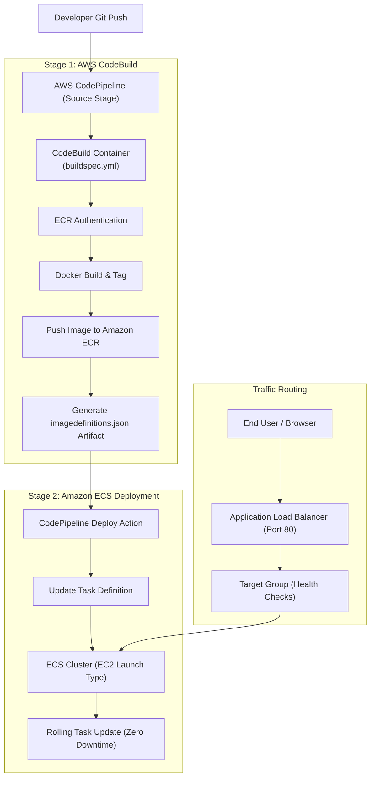

# Automated CI/CD with AWS CodePipeline, Amazon ECR & ECS (EC2 Launch Type)

<p align="center">
  <a href="https://github.com/codewithmuh/deploy-codepipeline-ecs-ec2/releases"></a>
  <a href="https://github.com/codewithmuh/deploy-codepipeline-ecs-ec2/stargazers"></a>
  <a href="https://github.com/codewithmuh/deploy-codepipeline-ecs-ec2/network/members"></a>
  <a href="LICENSE"></a>
  <a href="https://youtube.com/@codewithmuh"></a>
  <br>
  
  
  
  
</p>

## Overview

In this comprehensive production tutorial, you will learn how to containerize an application, automatically build and push Docker images to **Amazon ECR**, and deploy them to an **Amazon ECS** cluster using the **EC2 launch type**. The entire continuous integration and continuous deployment process is orchestrated using **AWS CodePipeline** and **AWS CodeBuild**, with an **Application Load Balancer (ALB)** distributing traffic across ECS container tasks.

---

## 🏗️ Architecture



---

## 📁 Repository Structure

```
├── app.py              # Flask / Python sample web application
├── Dockerfile          # Multi-stage lightweight container definition
├── buildspec.yml       # AWS CodeBuild lifecycle commands & image definitions
├── LICENSE             # MIT License
└── README.md           # Step-by-step setup and architecture guide
```

---

## 🛠️ Step-by-Step Implementation Guide

### 1. Create Amazon ECR Repository
Create a private container registry to store your Docker images:
```bash
aws ecr create-repository --repository-name ecs-demo --region ap-south-1
```

### 2. Configure `buildspec.yml`
Ensure your AWS Account ID and region match in [`buildspec.yml`](buildspec.yml):
```yaml
version: 0.2
phases:
  pre_build:
    commands:
      - echo Logging in to Amazon ECR...
      - aws ecr get-login-password --region $AWS_REGION | docker login --username AWS --password-stdin $REPO_URI
      - IMAGE_TAG=$(echo $CODEBUILD_RESOLVED_SOURCE_VERSION | cut -c 1-7)
  build:
    commands:
      - echo Building Docker image...
      - docker build -t $REPO_URI:$IMAGE_TAG .
      - docker tag $REPO_URI:$IMAGE_TAG $REPO_URI:latest
  post_build:
    commands:
      - echo Pushing Docker images...
      - docker push $REPO_URI:$IMAGE_TAG
      - docker push $REPO_URI:latest
      - printf '[{"name":"ecs-demo","imageUri":"%s"}]' $REPO_URI:$IMAGE_TAG > imagedefinitions.json
artifacts:
  files: imagedefinitions.json
```

### 3. Provision Amazon ECS Cluster (EC2 Launch Type)
1. Navigate to **Amazon ECS** in the AWS Console.
2. Choose **Create Cluster** and select **Amazon EC2 instances**.
3. Configure your EC2 instance type (`t3.medium` recommended) and desired capacity.
4. Create an **Application Load Balancer** with a HTTP target group pointing to port 80/8080.
5. Create a **Task Definition** with container port mapping matching your application.
6. Create an **ECS Service** linked to your ALB Target Group.

### 4. Setup AWS CodePipeline
1. Open **AWS CodePipeline** -> **Create pipeline**.
2. **Source**: Connect to your GitHub repository (`main` branch).
3. **Build**: Select **AWS CodeBuild**, link your build project, and ensure the service role has permissions for `ecr:GetAuthorizationToken` and `ecr:BatchCheckLayerAvailability`.
4. **Deploy**: Select **Amazon ECS**, select your cluster and service name, and use the `imagedefinitions.json` artifact from CodeBuild.

---

## 🧹 Clean Up Resources

To prevent unwanted AWS billing after completing the walkthrough:
1. Delete the ECS Service and ECS Cluster.
2. Terminate the EC2 container instances and delete Auto Scaling Groups.
3. Delete the Application Load Balancer and Target Group.
4. Delete the CodePipeline and CodeBuild projects.
5. Delete the Amazon ECR repository and images.

---

## 📄 License
This project is open-source under the [MIT License](LICENSE).
